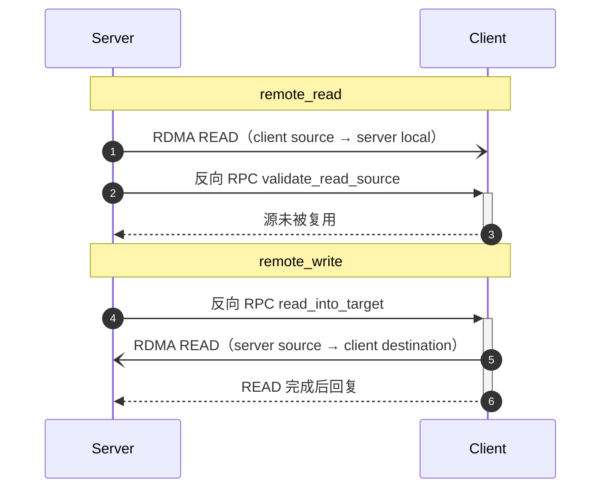

# RuaPC：安全的 RDMA 零拷贝

上一篇[《一种安全的 RDMA Buffer 复用策略》](/rdma/rdma_buffer_safe_reuse.html)的结尾提到，希望把这套策略直接做进 RPC 框架、开箱即用。RuaPC 大致就是照这个思路实现的，这篇说说它里面 safe zero-copy 和内存语义是怎么落地的。

### 1. 零拷贝的问题

普通 RPC 的数据要经过序列化和框架自己的临时 buffer，请求结束、超时、取消，把临时 buffer 丢掉就行。零拷贝跳过了这一层，数据直接在注册过的 buffer 之间 DMA，请求里只带地址和长度。这时候 buffer 的生命周期又回到应用手里，而网卡是异步干活的，请求结束不代表 DMA 结束。

框架得替应用回答：谁可以读写这块 buffer，什么时候能确定网卡不再碰它，超时或者取消之后还能不能复用。没有明确答案的话，就只能用超时断连接这种办法，拿连接的生命周期去近似 buffer 的生命周期，上一篇已经讨论过这么做的代价。

RuaPC 的做法是把两件事拆开：只用 READ，让所有会被 DMA 写的 buffer 都由发起 READ 的一方拥有；内存什么时候能释放，只认完成证据。

### 2. 只用 READ

RDMA Write 的麻烦在于，写权限和完成证据不在一个地方。远端拿到 rkey 就能写，而 buffer 的所有者在本地，既收不到这次写的完成事件，也没法在超时之后判断写到底发没发生。断连接、Read 后确认，其实都是在补这个缺口。

Read 反过来：发起方是读取方，目标 buffer 在自己手里，CQ 完成事件也在自己手里。所以 RuaPC 没有实现 RDMA Write，两个方向都用 READ：

1. `remote_read`：handler 发起 READ，把 client 的源读进自己的 buffer；
2. `remote_write`：handler 先给 client 发一个反向 RPC，请 client 发起 READ，把 handler 的源读进 client 自己的 write space。

这样，会被异步写的 buffer 一定由发起方持有，写坏了也是自己的事；只读的源不会被写坏，只需要确认读到的数据是不是最新的。

### 3. 所有权和完成证据

读源是借用，`with_read_buffer(&src)` 之后，源在这次 RPC 期间不可变。写目标要么 move 给框架（`with_write_buffers`），要么借出槽位（`with_write_buffer_mut`），借出期间槽位里是空 buffer，调用方的 `&mut` 覆盖不到 DMA 内存。地址、key、SGE 都由框架从持有的 buffer 推导，高层 API 不接收这些参数。`ruapc`、`ruapc-memory`、`ruapc-wire` 都 `forbid(unsafe_code)`，分配和 verbs 操作留在 `ruapc-bufpool` 和 `ruapc-rdma`。

释放内存只认完成证据。READ 的目标 buffer 会 move 进 plan，唯一的释放凭证是 CQ 给出的 `Completion`，或者 QP 成功销毁。`Completion` 不能 clone，会校验 CQ、QPN 和 sequence floor，WRID 的 62 bit sequence 不会 wrap。超时、取消、drop、ERR、断连都不算数，连接断了只会让等待方早点失败，不会提前释放 DMA 还在用的内存。

写目标的状态机很小：`Available`、`Reading`、`Sealed`。`start_read` 在同一把锁里把整个 buffer 集合 move 进 READ plan，再把 `ReadRecovery` 放回原位，中间没有 await。DMA 期间 CPU copy 和竞争 READ 会拿到 `BuffersInUse`，只有 recovery 能把 buffer 还回来，失败或者取消也一样。调用结束时 `seal()` 撤销残留的 writer。`BufferReply` 只序列化业务返回值，本地 buffer 的可用性不走 wire，业务成功和 buffer 已归还是两件事。

### 4. 读源的校验

读源不会被写坏，但可能被复用。做法和上一篇一样：READ 完成后，reader 用反向 RPC 问源端刚才那份源还安不安全。关键在谁来回答。waiter 里只有一个 mpsc 发送端，不存指针也不存借用；原始请求 future 在 poll 的时候处理这个 mailbox。所以只有仍然被 poll、仍然持有借用的 future 能给出肯定回答，`mem::forget` 之后没人回答，probe 只能超时。

反向 RPC 还必须落在原请求的那条连接上，查表时 `(msgid, conn_id)` 同时匹配，单个请求 ID 什么也选不中。

代价是 `remote_read` 多一次 RTT 左右，而且这套协议依赖两个前提：同一个请求 ID 在校验窗口内不复用，对端配合。这些在文档里都写清楚了。

### 5. 尾声

收益比较直接：超时和取消只影响一次请求，不用断连接；不会出现忘了等 READ 完成就复用 buffer 的应用 bug；数据面没有 CPU 拷贝和序列化，handler 可以原地处理 buffer 再传给下一次 transfer。同一套 API 在 TCP、WebSocket、HTTP/2 上走反向 RPC 的 inline copy，先拿普通网络开发再切 RDMA 也行，只是流传输单个 batch 有 64 MiB 上限。

不足也有：`remote_read` 多一次 RTT；lent 的写目标在调用返回时会等 READ 回收，可能超出 RPC deadline；`mem::forget` 这类操作还是会泄漏资源。safe 保证的是本地内存不被 DMA 竞态破坏，不是数据一定正确。

后面想等 Rust 的 `!Forget` 稳定之后，把借用中的请求 future 变成不可 forget，校验就不用再 handoff 到源 future，能省一点开销。代码在 [SF-Zhou/ruapc](https://github.com/SF-Zhou/ruapc)。
